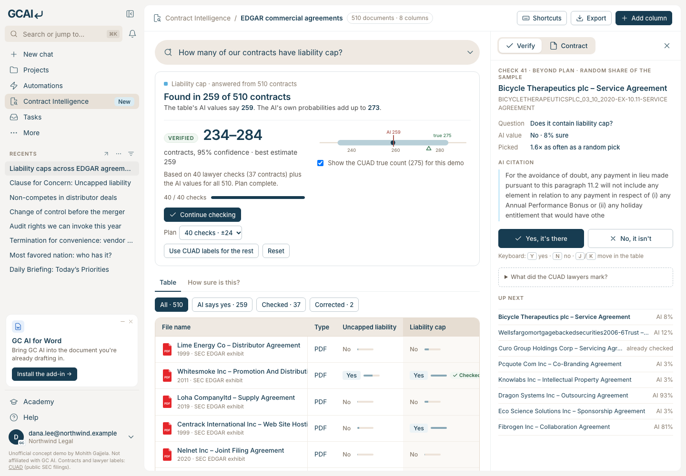

# Verified counts for GC AI Contract Intelligence

**Live demo:** https://mohith26.github.io/gcai-verified-counts/

Contract Intelligence answers portfolio questions like "how many of our vendor MSAs cap liability?" with a count: *Found in 412 of 438*. That count is only as good as every extraction behind it, and GC AI's own guidance tells counsel to spot-check rows they have reviewed. This concept turns those spot checks into a **verified count with a 95% range**: GC AI picks the contracts where its extraction is least sure (plus a random share), a lawyer answers yes or no in a side panel, and every answer corrects the count for all contracts, not just that row. The estimator is unbiased whatever the AI's accuracy, and it tells you up front how many checks a given precision needs.



## Real data

The vault is **CUAD v1** (The Atticus Project, CC BY 4.0): 510 real commercial contracts filed with the SEC, each annotated by lawyers for 41 clause types. Eight are used as columns (uncapped liability, liability cap, termination for convenience, change of control, non-compete, exclusivity, audit rights, most favored nation). The CUAD annotations are the "lawyer checks".

The "AI extraction" is a stand-in I can run for free (`scripts/build_vault.py`): a clause-level logistic regression over hashed unigrams and bigrams, scored per clause and maxed per contract, trained with 5-fold cross-fitting so every contract's value comes from a model that never saw it. Its mistakes are real (accuracy 75-95% by column) and, like an LLM's stated confidence, its probabilities are not calibrated to this portfolio.

## Results (`scripts/report.mjs` → `data/results.json`, 2,000 simulated audits per cell)

| Column | True count | AI count | Random 40 checks | Verified, 40 checks | Coverage |
|---|---|---|---|---|---|
| Liability cap | 275 | 259 | ±81 | **±28** | 97.5% |
| Audit rights | 214 | 191 | ±80 | **±35** | 98.6% |
| Uncapped liability | 111 | 122 | ±67 | **±46** | 96.2% |
| Change of control | 121 | 93 | ±69 | **±53** | 96.9% |
| Termination for convenience | 183 | 156 | ±78 | **±57** | 95.0% |
| Non-compete | 119 | 57 | ±69 | **±56** | 95.0% |
| Exclusivity | 180 | 91 | ±78 | **±65** | 95.0% |
| Most favored nation | 28 | 2 | ±32 | **±31** | 99.7% |

"±" is the average half-width of the 95% range. "Random 40 checks" estimates from the 40 lawyer answers alone; "Verified" combines them with the AI values for all 510 and picks checks where the AI is unsure. Coverage is how often the verified range contained the true count.

- On liability caps, 40 checks give a range **2.9x tighter** than checking 40 contracts at random, and it held in 97.5% of audits.
- The AI-only count misses by 11 to 89 contracts depending on the column (exclusivity: 91 found, 180 true), and nothing in a plain count tells you which column you are in. The verified range says so.
- Gains track extraction quality: on strong columns the range is 2-3x tighter than random checking; on weak ones (exclusivity, non-compete) it is only slightly tighter, but still valid.

## How it works (`src/verify.js`)

1. **Start from the AI.** Sum the AI's probability over all N contracts.
2. **Pick checks by uncertainty.** Draw contracts with probability π_i ∝ √(p_i(1 − p_i)), mixed 80/20 with uniform so every contract can be drawn (with replacement; a repeat costs no extra lawyer time).
3. **Correct the whole count.** For each check, z = (lawyer answer − p_i)/π_i. The verified estimate is Σ p_i + mean(z) (Hansen-Hurwitz; the prediction-powered inference rectifier of Angelopoulos et al., *Science* 2023, with an active sampling design in the spirit of Zrnic and Candès 2024). It is unbiased for any p and any π > 0.
4. **Range.** Student-t interval from the spread of z. Small samples of a heavy-tailed z understate the spread (a rare missed clause shows up in few draws), so the per-check variance is floored at the design's planning variance; the floor can only widen the range.
5. **Plan.** The planning variance gives checks-needed for a target precision before anyone starts (the "40 checks · ±24" menu).

The app is a rebuild of the GC AI web app shell (sidebar, Contract Intelligence vault table, ask bar, right panel) with the feature in place: the verified-count card, a **Verify** queue (keyboard `Y`/`N`), checked/corrected badges in the table, a **How sure is this?** tab, CSV export of the audit, per-column plans, URL deep links (`#/vault?col=non_compete&tab=evidence`), and localStorage persistence. On first visit it opens on a finished 40-check review answered with the CUAD labels; **Reset** lets you do it yourself.

## Tests

```
node --test test/verify.test.mjs
```

14 tests: quantile functions; the vault matching CUAD's lawyer counts; design probabilities; draw frequencies; exactness with a perfect AI; a **randomised unbiasedness property test** for both designs; a **randomised coverage test on a deliberately miscalibrated AI**; the variance floor never narrowing the range; the classical baseline; planning scaling; committed-results checks; and a **headline-number test** that recomputes `data/results.json` from data + code. A GitHub Actions workflow is committed at `ci/test.yml` (move it to `.github/workflows/` once the publishing token has the `workflow` scope).

## Run it

```
curl -L https://github.com/TheAtticusProject/cuad/raw/main/data.zip -o cuad.zip && unzip cuad.zip -d cuad
python3 scripts/build_vault.py cuad/CUADv1.json   # needs numpy; writes data/vault.json (~1 min)
node scripts/report.mjs                           # data/results.json
python3 -m http.server                            # open http://localhost:8000
```

## Honest limitations

- **Not GC AI's extractor.** Mine is a simple classifier. An LLM extractor will be more accurate, which makes verified ranges tighter for the same number of checks; the guarantee does not depend on which extractor it is.
- **Coverage is approximate.** The interval is a t-interval with a variance floor. Simulated coverage was 95.0-99.7% at 40 checks on every column, but rare clauses need more checks before the range is informative (most favored nation: ±31 at 40 checks).
- **Stopping early.** The plan size is fixed before checking; stopping as soon as the range looks good would need an anytime-valid interval (confidence sequences), which this demo does not implement. The UI labels ranges as provisional until the plan is done.
- **Presence questions only.** Counts of yes/no columns. Sums of values (total exposure across MSAs) work the same way but need value-level checks.
- **Lawyer answers are assumed right.** The CUAD annotations stand in for the checking lawyer.

## Prior art and what is new

- eDiscovery (TAR) has used random samples to estimate recall for a decade, and prediction-powered inference is published statistics. Harvey added confidence-based scoring to prioritise review (Apr 2026); vendors recommend spot-checking extraction accuracy.
- I did not find a contract-intelligence product that turns spot checks into a corrected portfolio count with a stated confidence range, or that plans how many checks a question needs. GC AI's docs, changelog and Contract Intelligence pages (Nov 2026) describe citations and hand-editing cells, not verified counts.

Unofficial concept demo by Mohith Gajjela. Not affiliated with GC AI. Contracts and lawyer labels from CUAD (public SEC filings).
